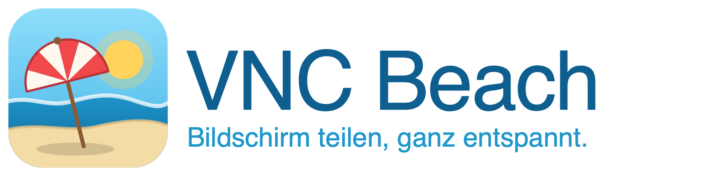

<p align="center"></p>

# VNC Beach

Ein VNC-Server und -Viewer, der einfach funktioniert: auf macOS und Windows, gratis und Open Source. Die Projektseite liegt unter [`docs/`](docs/index.html) (GitHub Pages).

Server und Viewer sprechen Standard-VNC (RFB 3.8, RFC 6143). Der VNC-Beach-Viewer verbindet sich deshalb auch mit anderen VNC-Servern (TigerVNC, RealVNC, macOS-Bildschirmfreigabe mit VNC-Passwort). Umgekehrt können sich TigerVNC, RealVNC Viewer & Co. mit dem VNC-Beach-Server verbinden.

## Plattformen

| Gerät | Viewer | Server | Besonderheiten |
| --- | --- | --- | --- |
| macOS | ja | ja | Eine App; Symbol in der Menüleiste; auf Wunsch schon am Anmeldefenster erreichbar. Braucht Bildschirmaufnahme und Bedienungshilfen. Alternativ die eingebaute Bildschirmfreigabe als Server (ohne Zwischenablage). |
| Windows (64-Bit, 10/11) | ja | ja | Eine Datei, die sich beim ersten Start selbst einrichtet (Startmenü „VNC Beach“); Symbol im Infobereich; als Windows-Dienst auch im Sperr- und Anmeldebildschirm erreichbar. **Ohne eingeschaltete Monitore** braucht es einmalig den virtuellen Bildschirmtreiber `usbmmidd_v2` von Amyuni, siehe [Ohne eingeschaltete Monitore](#ohne-eingeschaltete-monitore-windows). |
| iPad und iPhone (iOS 18+) | ja | nein | Nur Viewer: verbindet sich mit jedem VNC-Server, teilt aber keinen eigenen Bildschirm. Derzeit in der Testphase über TestFlight, noch nicht öffentlich, siehe [iPad und iPhone](#ipad-und-iphone). |

Der Betrieb ohne Monitor ist nur auf Windows ein Thema. Auf dem Mac gibt es die Funktion nicht und sie wurde dort auch nicht gebraucht: Ein Mac ohne angeschlossenen Monitor behält einen Bildschirm in Standardauflösung, den VNC Beach oder die Bildschirmfreigabe übertragen. Wer dort eine bestimmte Auflösung braucht, nimmt einen HDMI-Dummy-Stecker. Die iOS-App hat keinen Server und ist davon nicht betroffen.

## Stand

Version 0.2.5. Umgesetzt:

- Bildschirmübertragung mit ZRLE-Kompression; gesendet werden nur geänderte 64×64-Kacheln
- VNC-Passwort-Authentifizierung
- Maus mit drei Tasten und Scrollrad; Retina/HiDPI wird umgerechnet
- Tastatur: Zeichen werden als Text eingefügt und kommen dadurch unabhängig vom Tastaturlayout an (`@`, `€`, Umlaute). Shortcuts mit Strg/Cmd lösen echte Tasten aus; Strg und Cmd werden zwischen Mac und Windows automatisch zugeordnet, Strg+Alt+Entf per Knopf.
- Zwischenablage für Text in beide Richtungen (Latin-1, wie im Standard)
- Dateiübertragung zwischen Desktop-Viewer und VNC-Beach-Server: lokale Dateien ins VNC-Fenster ziehen, Serverdateien über „Dateien“ herunterladen
- Auflösungswechsel während der Sitzung (DesktopSize)
- Mehrere Bildschirme: Der Server teilt standardmäßig alle Bildschirme als einen virtuellen Schreibtisch (auch für fremde Viewer) und meldet die Anordnung per ExtendedDesktopSize; VNC-Beach-Viewer und iPad-App schalten in der Sitzung auf einen einzelnen Bildschirm um und fordern dann nur noch diesen Ausschnitt an
- Viewer mit Verbindungsdialog; das Fenster passt sich an den entfernten Bildschirm an
- Favoriten im Viewer: mehrere Rechner mit Name, Adresse und Passwort speichern, bearbeiten und per Doppelklick verbinden
- Einstellungen pro Verbindung (Farbtiefe, Nur ansehen, Darstellung, Zwischenablage, Vollbild, Fenstergröße) mit Standardwerten, die jeder Favorit einzeln überschreibt
- Server im selben Programm als Hintergrunddienst mit Symbol im Infobereich bzw. in der Menüleiste, Autostart beim Anmelden und Status im Viewer (Windows und macOS)
- Vor der Anmeldung erreichbar: Windows-Dienst (auch Sperrbildschirm und UAC), LaunchAgent am macOS-Anmeldefenster, Servermodus für den unbeaufsichtigten Mac
- Windows ohne eingeschaltete Monitore: automatischer virtueller Bildschirm mit 2560 × 1440 (mit Treiber)
- Erreichbarkeit: alternative Adressen, SSH-Anmeldung (auch FileVault-Entsperrung), Wake-on-LAN über ein Zugangsgerät
- Selbst-Update aus den GitHub-Releases (macOS und Windows)
- Konto mit Organisationen: Anmeldung mit GitHub oder Google an einem selbst betreibbaren Koordinationsserver, alle eigenen und geteilten Geräte im Viewer, Verbindung ohne VNC-Passwort über kurzlebige Tickets, siehe [Konto und Organisationen](#konto-und-organisationen)
- Windows: Die heruntergeladene `VNC-Beach-Windows.exe` kopiert sich beim ersten Start nach `%LOCALAPPDATA%\Programs\vnc-beach\vnc-beach.exe`, legt im Startmenü „VNC Beach“ an und löscht den Download. Eine ältere Datei überschreibt keine neuere Installation.
- iPad- und iPhone-App als Viewer, derzeit in der Testphase über TestFlight

Geprüft auf macOS und Windows 11 in beiden Richtungen: Verbindung, Passwort, Bild, Maus, Tastatur, Zwischenablage, Dateiübertragung, Auflösungswechsel, mehrere Bildschirme, Windows-Dienst vor der Anmeldung und der virtuelle Bildschirm ohne Monitore. Nicht praktisch geprüft sind das macOS-Anmeldefenster, der FileVault-Neustart und der Servermodus des Macs nach einem echten Stromausfall.

## Aufbau

| Crate | Inhalt |
| --- | --- |
| `crates/rfb` | Protokoll: Handshake, VNC-Auth, Nachrichten, Pixelformate, ZRLE |
| `crates/beach-server` | Server: Bildschirmaufnahme (`xcap`), Eingaben (`enigo`), Zwischenablage (`arboard`) |
| `crates/beach-viewer` | Viewer: Fenster und Eingaben (`eframe`/`egui`), Hintergrunddienst, Windows-Dienst, Updates |
| `crates/beach-access` | Erreichbarkeit: SSH-Anmeldung, Wake-on-LAN, alternative Adressen |
| `crates/beach-account` | Konto: API-Typen des Koordinationsservers, signierte Verbindungstickets |
| `crates/beach-coord` | Koordinationsserver: Anmeldung, Organisationen, Geräte, Tickets (`axum`, SQLite) |
| `crates/beach-mobile` | Client als C-Bibliothek für die iOS-App |
| `apps/ios` | iPad- und iPhone-App (SwiftUI) |

## Nutzung

Voraussetzung ist Rust (stable).

```sh
cargo build --release
```

### Server

```sh
./target/release/beach-server                     # Port 5901, erzeugt ein Zufallspasswort und gibt es aus
./target/release/beach-server --password geheim   # eigenes Passwort (max. 8 Zeichen, VNC-Limit)
./target/release/beach-server --list-displays     # Bildschirme auflisten
./target/release/beach-server --display 1 --port 5902 --fps 30   # nur Bildschirm 1; Standard: alle („all“), auch „primary“; 60 Bilder pro Sekunde
./target/release/beach-server --view-only         # nur zuschauen, keine Eingaben
```

Das Passwort lässt sich auch über `VNC_BEACH_PASSWORD` setzen.

**macOS:** Das Programm, aus dem der Server gestartet wird (Terminal, iTerm …), braucht zwei Berechtigungen unter *Systemeinstellungen → Datenschutz & Sicherheit*:

- **Bildschirm- & Systemaudioaufnahme:** Fehlt sie, sehen Viewer nur Hintergrundbild und Menüleiste. Der Server warnt beim Start.
- **Bedienungshilfen:** Fehlt sie, haben Maus und Tastatur keine Wirkung.

### Viewer

```sh
./target/release/beach-viewer                       # Verbindungsdialog mit Favoriten
./target/release/beach-viewer --background          # Windows: nur Infobereich-Symbol und Server
```

Adressen im Formular: `mac.local` (Port 5900), `192.168.1.20:1` (Display 1 = Port 5901), `192.168.1.20::5999` (Port explizit). Der VNC-Beach-Server lauscht standardmäßig auf 5901, also `rechner:1` eingeben.

**Favoriten:** Links im Verbindungsdialog steht die Favoritenliste. Name, Adresse und Passwort rechts eingeben und „Als Favorit speichern" klicken; ein Klick auf einen Favoriten lädt ihn zum Bearbeiten ins Formular („Speichern", „Favorit löschen"), ein Doppelklick oder der Pfeil rechts in der Karte verbindet. Ab sechs Favoriten gibt es ein Suchfeld über der Liste. „Neu" leert das Formular für einen weiteren Favoriten.

#### Geräte über alternative Wege erreichen und vorbereiten

Im Desktop-Viewer und in der iOS-App ergänzt **Erreichbarkeit & Start** einen Favoriten um optionale
Fähigkeiten. Zielgeräte können Macs, Windows-PCs, Linux-Rechner, Raspberry Pis
oder Server sein. Voraussetzung für die Bildschirmverbindung ist jeweils ein
erreichbarer Standard-VNC-Server.

1. Unter **Alternative Adressen** zusätzliche VNC-Adressen eintragen, etwa die
   LAN-Adresse neben dem Tailscale-Namen. **Verbinden** prüft die Adressen der
   Reihe nach und verwendet den ersten antwortenden VNC-Server. Eine abgelehnte
   VNC-Anmeldung wird angezeigt und nicht an der nächsten Adresse wiederholt.
2. Bei Bedarf **SSH-Anmeldung anbieten** aktivieren und SSH-Adresse sowie
   Benutzername ergänzen. **Per SSH anmelden** fragt das SSH-Passwort ab oder
   verwendet den ausgewählten privaten SSH-Schlüssel. Danach wartet VNC Beach
   bis zu 90 Sekunden auf den VNC-Server und verbindet sich. Auf unterstützten
   Macs mit Apple-Chip ab macOS 26 kann die Passwort-Anmeldung FileVault
   entsperren. Dafür müssen „Entfernte Anmeldung“ und das Netzwerk bereits vor
   dem Entsperren verfügbar sein. Ein SSH-Abbruch allein gilt nicht als
   bestätigte Entsperrung. Der echte FileVault-Neustart wurde bisher nicht getestet.
3. Bei Bedarf **Wake-on-LAN anbieten** aktivieren, die MAC-Adresse der
   Netzwerkkarte und die lokale Broadcast-Adresse mit Port eintragen, etwa
   `192.168.50.255:9`. **Aufwecken** sendet ein Magic Packet und wartet danach
   auf VNC. Hardware und Betriebssystem des Zielgeräts müssen Wake-on-LAN
   unterstützen und dafür eingerichtet sein.

Für Wake-on-LAN von unterwegs ein **SSH-Zugangsgerät** im Netz des Zielgeräts
hinzufügen. Das kann ein Pi, NAS, Mac oder Windows-Rechner sein. Eine POSIX-Shell
benötigt Python 3 oder Perl; unter Windows wird PowerShell verwendet. Bei
mehreren Zugangsgeräten versucht VNC Beach sie der Reihe nach, bis eines das
Signal gesendet hat. Ohne Zugangsgerät wird aus dem aktuellen Netz des Viewers
gesendet. Ein gesendetes Signal bestätigt noch nicht, dass der Rechner startet.

Die Netzwerkwege werden separat eingerichtet. Beispielsweise können Pi und NAS
als [Tailscale-Subnet-Router](https://tailscale.com/docs/features/subnet-routers)
dieselbe lokale Mac-Adresse freigeben; Tailscale übernimmt dann die Umschaltung.
VNC Beach installiert keine Routersoftware und ändert keine Netzfreigaben.
Nach einem Aufwecksignal kann bei FileVault zusätzlich eine SSH-Anmeldung nötig
sein. Den laufenden Versuch dann abbrechen und **Per SSH anmelden** wählen.

Beim ersten SSH-Zugriff zeigt VNC Beach den SHA-256-Fingerabdruck des Geräts.
Den Fingerabdruck über einen bekannten Zugang prüfen und ausdrücklich bestätigen.
Die bestätigten Geräteschlüssel liegen am Desktop unter `ssh_hosts` neben
`servers.toml`, unter iOS in Application Support innerhalb des App-Containers.
Ändert sich ein Schlüssel, stoppt die Anmeldung vor der Passwortübertragung.
SSH-Passwörter und Schlüssel-Passphrasen werden nur für den jeweiligen Versuch
verwendet und nicht gespeichert. Das SSH-Passwort ist unabhängig vom
VNC-Passwort. Bestehende Favoriten bleiben unverändert nutzbar.

Auf iPhone und iPad unter **Computer bearbeiten → Erreichbarkeit & Start** die
Angaben ergänzen. Bei nicht erreichbarem VNC erscheinen **Per SSH anmelden** und
**Aufwecken & verbinden**, sofern sie eingerichtet sind. Nach dem Aufwecken lässt
sich direkt zur SSH-Anmeldung wechseln. Jeder Versuch kann abgebrochen werden.
Private SSH-Schlüssel werden über die Dateien-App importiert und im
Geräteschlüsselbund gespeichert. Nur für den laufenden Versuch entsteht eine
geschützte temporäre Schlüsseldatei.

Unter iOS benötigt Wake-on-LAN mindestens ein SSH-Zugangsgerät, auch im eigenen
WLAN. Das Aufwecksignal sendet dann Pi, NAS oder ein anderer Rechner vor Ort.
Direkter UDP-Broadcast auf einem iPhone oder iPad benötigt eine zusätzliche
[Apple-Berechtigung](https://developer.apple.com/documentation/bundleresources/entitlements/com.apple.developer.networking.multicast),
die diese App nicht voraussetzt.

Für die Entwicklung prüft `python3 tools/test-access-ssh.py` Schlüsselanmeldung,
Geräteschlüsselprüfung und Wake-on-LAN über einen temporären OpenSSH-Server auf
Loopback. `cargo run -p beach-viewer --example access-preview -- /tmp/access.png`
erstellt eine Vorschau des Einstellungsbereichs ohne Hintergrunddienst.
`tools/test-access-auth.py` prüft zusätzlich Passwort-Anmeldung, mehrstufige
SSH-Abfragen und Verbindungsabbrüche mit Testservern; dafür wird eine separate
Python-Umgebung mit Paramiko benötigt. Mit `--ios` prüft es zusätzlich den
Swift/Rust-Verbindungsablauf im iPad-Simulator.

Die Liste liegt als `servers.toml` unter `~/Library/Application Support/vnc-beach/` (macOS) bzw. `%APPDATA%\vnc-beach\` (Windows) und lässt sich auch von Hand bearbeiten. Passwörter stehen darin im Format von `vncpasswd` (DES mit festem Schlüssel, wie in `~/.vnc/passwd`). Das verhindert nur das Mitlesen auf einen Blick, ist aber keine Verschlüsselung: Wer die Datei hat, kann die Passwörter zurückrechnen.

**Einstellungen pro Verbindung:** Unter dem Passwortfeld klappt „Einstellungen" auf. Jede Zeile steht auf „Standard: …" oder auf einem eigenen Wert, der nur für diesen Favoriten gilt. „Standardeinstellungen …" öffnet die Werte, die für alle Verbindungen gelten. Es gibt:

| Einstellung | Werte |
| --- | --- |
| Eingabe | Tastatur und Maus senden / Nur ansehen (in der Sitzung umschaltbar) |
| Darstellung | An das Fenster anpassen / Originalgröße mit Scrollen (Knopf „1:1" in der Leiste) |
| Farben | Volle Farbtiefe / 16 Bit / 256 Farben für langsame Leitungen |
| Zwischenablage | Synchronisieren / Nicht synchronisieren |
| Tastenkürzel | Automatisch / Strg und Cmd tauschen / Unverändert senden |
| Vollbild | Beim Verbinden / Nein (Knopf „Vollbild" in der Leiste) |
| Fenstergröße | An den Bildschirm anpassen / Beibehalten |

Die Standardwerte stehen in `config.toml` neben `servers.toml` unter `[viewer]`, die Abweichungen eines Favoriten in `servers.toml` unter `[server.settings]`.

**Mehrere Bildschirme:** Teilt der Server alle Bildschirme (Standard des VNC-Beach-Servers), zeigt der Viewer sie zunächst nebeneinander. Meldet der Server die Anordnung (ExtendedDesktopSize, wie TigerVNC), erscheint in der Leiste „Alle Bildschirme“ mit einem Eintrag je Bildschirm; die Auswahl zeigt nur noch diesen, passt das Fenster an und fordert vom Server nur noch diesen Ausschnitt an (`FramebufferUpdateRequest` mit Rechteck, Standard-RFB).

**Zwischenablage:** Der Viewer beobachtet die lokale Zwischenablage und schickt jede Änderung an den Server, auch schon beim Verbinden. Was auf der Gegenseite kopiert wird, landet lokal. Ein Rechtsklick → Einfügen auf der Gegenseite funktioniert damit ohne Strg+V im Viewer. Ausnahme ist die Bildschirmfreigabe von macOS: Apples Server ignoriert die Zwischenablage-Nachrichten fremder Viewer in beide Richtungen (gemessen mit `cargo run -p rfb --example probe`). Dort fügt Strg+V bzw. Cmd+V den lokalen Text per Tastatur ein; Rechtsklick → Einfügen und die Richtung Mac → Viewer gehen nur mit dem VNC-Beach-Server auf dem Mac.

**Dateien übertragen:** Verbinde dich mit einem aktuellen VNC-Beach-Server und öffne in der Sitzungsleiste **Dateien**. Der angezeigte Serverordner ist das Ziel für Dateien, die du vom lokalen Finder oder Explorer ins VNC-Fenster ziehst. Anfangs ist das der Download-Ordner des Serverbenutzers, sofern er innerhalb seines Benutzerordners liegt, sonst der Benutzerordner selbst. Öffne einen Unterordner oder gib seinen relativen Pfad ein, um das Ziel zu ändern. Der Ordner unter dem Mauszeiger im entfernten Desktop ist dabei nicht das Übertragungsziel.

Zum Übertragen in die Gegenrichtung klicke neben einer Serverdatei auf **Herunterladen**. Unter **Lokal speichern** wählst du den lokalen Zielordner. Alternativ zum Ziehen kannst du lokale Dateien mit **Dateien auswählen …** hochladen. Mehrere Dateien werden nacheinander übertragen. Ganze Ordner müssen vorher als ZIP-Datei gepackt werden.

Übertragungen kopieren die Dateien; die Originale bleiben erhalten. Vorhandene Zieldateien werden nicht überschrieben. Fortschritt und **Abbrechen** erscheinen im Dateibereich. Bei Abbruch oder Verbindungsverlust wird die unvollständige Datei entfernt; bereits vollständig kopierte Dateien bleiben erhalten. Übertragbar sind reguläre Dateien mit plattformübergreifend gültigen Namen innerhalb des Benutzerordners auf dem Server. Bei **Nur ansehen** ist die Dateiübertragung deaktiviert.

Die Dateiübertragung verwendet eine ausgehandelte VNC-Beach-Erweiterung. Andere VNC-Server, darunter die eingebaute macOS-Bildschirmfreigabe, bieten diese Funktion nicht an. Die normale Bildschirmverbindung bleibt kompatibel. Die iOS-App bietet derzeit keine Dateiübertragung.

**Tastenkürzel:** Bei „Automatisch" erkennt der Viewer einen Mac als Gegenstelle (Bildschirmfreigabe meldet sich als RFB 3.889, der VNC-Beach-Server nennt sein System im Namen) und schickt von Windows aus Strg als Cmd: Strg+C wird Cmd+C. Umgekehrt wird Cmd vom Mac auf einem Windows-Rechner zu Strg. Zwischen zwei gleichen Systemen bleibt alles wie gedrückt. Die Bildschirmfreigabe von macOS liest Tasten anders als alle anderen Server (Alt_L ist dort Cmd, Meta_L ist Option); der Viewer schickt deshalb je nach Gegenstelle andere Keysyms, damit Alt immer Option und Strg bzw. Cmd immer Cmd ergibt.

### Server im Viewer

Der Server steckt im Viewer, auf Windows und auf dem Mac. `vnc-beach.exe --background` startet ohne Fenster: ein Symbol im Infobereich, dahinter der Server. Das Menü des Symbols zeigt den Stand („Server online, Port 5901, 1 Zuschauer"), öffnet den Viewer, hält den Server an oder startet ihn, schaltet „Beim Anmelden starten" und beendet den Dienst. Das Menü erscheint bei Links- wie Rechtsklick; „VNC Beach öffnen“ holt einen laufenden Viewer nach vorn, statt einen zweiten zu starten.

Im Viewer zeigt links unten „Dieser Computer" denselben Stand samt Passwort. „Einstellungen …" setzt Passwort (beim ersten Start wird eines erzeugt), Port, Bildschirme (alle, nur der Hauptbildschirm oder ein bestimmter; `display = "all" | "primary" | 1` in `config.toml`), Bilder pro Sekunde, „Nur ansehen", ob der Server überhaupt läuft und ob der Hintergrunddienst beim Anmelden startet (Windows: Registry-Eintrag `HKCU\…\Run\VNC Beach`, macOS: LaunchAgent). Läuft kein Hintergrunddienst, bietet der Viewer an, ihn zu starten.

Viewer und Hintergrunddienst sind getrennte Prozesse. Sie reden über einen Port auf `127.0.0.1`, den der Dienst in `%APPDATA%\vnc-beach\control.port` ablegt; die Server-Einstellungen liegen in `config.toml` unter `[server]`. Der Hintergrunddienst startet erst nach dem Anmelden, nicht schon am Anmeldebildschirm.

#### Vor der Anmeldung erreichbar (Windows und Mac)

VNC Beach richtet das beim ersten Start selbst ein: Der Viewer startet den Hintergrunddienst, und der prüft bei jedem Start, ob der Zugang vor der Anmeldung eingerichtet und aktuell ist. Fehlt etwas, fragt das System einmal nach Administratorrechten. Wer ablehnt, wird für diese Version nicht mehr gefragt; in den Server-Einstellungen lässt es sich nachholen („Auch im Sperrbildschirm und vor der Anmeldung erreichbar“ bzw. „Auch am Anmeldefenster erreichbar“) oder abschalten (`service = false` in `config.toml`).

**Windows:** VNC Beach richtet einen Windows-Dienst ein. Er kopiert das Programm nach `C:\Program Files\VNC Beach`, startet mit Windows und hält den Server als SYSTEM-Prozess in der Konsolensitzung am Laufen. Zuschauer sehen dann auch den Sperr- und Anmeldebildschirm sowie UAC-Abfragen und können dort PIN oder Passwort eingeben. Dabei stellt VNC Beach Tailscale auf „unbeaufsichtigt“ (`tailscale set --unattended`), damit es schon vor der Anmeldung verbunden ist. Das Symbol im Infobereich startet keinen eigenen Server mehr, sondern zeigt und steuert den des Dienstes („Windows-Dienst online …“). Passwort, Port und die anderen Einstellungen kommen weiter aus der `config.toml` des Benutzers, der den Dienst eingerichtet hat; Dateiübertragungen landen in dessen Profil. Nach einem Update erkennt der Hintergrunddienst die ältere Kopie in `Program Files` und fragt erneut nach Administratorrechten. Protokolle: `C:\ProgramData\VNC Beach\` (`service.log`, `agent.log`, `setup.log`).

**Mac:** VNC Beach legt einen LaunchAgent für das Anmeldefenster an (`/Library/LaunchAgents/at.schlossers.vnc-beach.loginwindow.plist`, macOS fragt nach einem Administratorpasswort). Er startet den Server, solange niemand angemeldet ist; nach der Anmeldung übernimmt der Server des Menüleisten-Symbols. Ein Update ersetzt die App an derselben Stelle, der LaunchAgent bleibt gültig. Protokolle: `/Library/Logs/VNC Beach/`.

**Servermodus nach Stromausfall:** In den Server-Einstellungen lässt sich der Mac ausdrücklich für unbeaufsichtigten Betrieb einrichten. Die normale Installation und ein gewöhnliches Update schalten FileVault nicht ungefragt ab. Erst „FileVault für diesen Mac deaktivieren“ und „Servermodus einrichten …“ starten diese Einrichtung mit dem lokalen Mac-Passwort. Der Servermodus:

- deaktiviert FileVault, aktiviert SSH und den automatischen Wiederanlauf nach Stromausfall und verhindert den Ruhezustand des Macs;
- richtet VNC Beach am Anmeldefenster sowie beim Anmelden ein;
- startet die bestehende eigenständige Tailscale-App über einen Benutzer-Dienst in `/Library/LaunchDaemons`, ohne eine Desktop-Anmeldung zu benötigen, und versucht die Verbindung bei Ausfällen alle 60 Sekunden erneut. Ein bereits eingerichteter `tailscaled`-Dienst wird ebenfalls unterstützt. Geräteeintrag, Adresse, Routen und sonstige Einstellungen bleiben erhalten. Tailscale muss vorher angemeldet und seine Netzwerkerweiterung genehmigt sein; die App-Store-Variante wird vor der Anmeldung nicht unterstützt;
- kann zusätzlich die automatische Anmeldung aktivieren, damit die vorhandenen Benutzer-Dienste starten. Dabei speichert macOS das Anmeldepasswort für die automatische Anmeldung. Der Bildschirm wird nach 15 Sekunden ausgeschaltet und verlangt beim Entsperren sofort das Passwort. Diese Sperre ersetzt den Schutz durch FileVault nicht.

Die gewählte Einrichtung wird rootgeschützt in `/Library/Application Support/VNC Beach/server-mode.json` gespeichert. Dort stehen nur Pfade und Optionen, kein Passwort. Das Mac-Passwort wird bei der Einrichtung über stdin und ein privates Terminal an die Systemprogramme übergeben, nicht über Kommandozeilenargumente oder VNC-Beach-Konfigurationen. Die ursprünglichen Einstellungen liegen im nur für root lesbaren Unterordner `before-server-mode`. Ein VNC-Beach-Update behält die Auswahl und aktualisiert nötigenfalls die verwalteten Startdateien nach der Administratorabfrage. Ist FileVault später wieder aktiv, zeigt VNC Beach den Reparaturbedarf an; es speichert kein Administratorpasswort, mit dem es eine erneute Verschlüsselung heimlich rückgängig machen könnte.

Die Einrichtung startet den Mac nicht neu. Ein kontrollierter Neustarttest muss bestätigen, dass Tailscale, SSH und VNC Beach am Anmeldefenster sowie die gewünschten Benutzer-Dienste erreichbar sind. Wenn macOS noch vor dem Start auf das FileVault-Passwort wartet, kann auch dieser Dienst nicht laufen. Ein davon unabhängiger Heimnetz-VPN-Zugang bleibt deshalb ein sinnvoller Wiederherstellungsweg. Die Passwortabfrage schützt nicht vor physischem Datenzugriff, wenn FileVault ausgeschaltet ist.

#### Ohne eingeschaltete Monitore (Windows)

Nur Windows; Mac und iOS-App sind nicht betroffen, siehe [Plattformen](#plattformen). Melden sich alle Monitore beim Ausschalten von Windows ab, zeigt Windows nur noch einen kleinen Ersatzbildschirm (oft 1024 × 768). Mit dem virtuellen Bildschirmtreiber „usbmmidd_v2“ von Amyuni Technologies stellt VNC Beach dann automatisch genau einen Bildschirm mit 2560 × 1440 bereit. Sobald ein echter Monitor zurück ist, entfernt VNC Beach ihn wieder, auch während einer Sitzung und im Windows-Dienst. Den Treiber richtet *Dieser Computer → Einstellungen → Virtueller Bildschirm → Treiber einrichten* einmalig mit Administratorrechten ein (oder `vnc-beach.exe --install-display-driver`). Er wird beim Hersteller geladen und steht unter dessen Lizenz. Details, Grenzen und Tests: [`docs/headless-windows.md`](docs/headless-windows.md).

Für „Rechner einschalten und aus der Ferne drauf“ braucht es zusätzlich:

- **Tailscale-Schlüssel:** im Tailscale-Admin-Panel für das Gerät „Disable key expiry“ wählen, sonst muss man sich alle paar Monate neu anmelden.
- **Einschalten (PC):** im BIOS/UEFI „Restore AC Power Loss“ auf „Power On“ (startet, sobald Strom da ist) und für Wake-on-LAN „Power On By PCI-E“ an, „ErP Ready“ aus. Unter Windows den Schnellstart abschalten (`HiberbootEnabled = 0`), dann weckt das Magic Packet auch aus dem ausgeschalteten Zustand. Das Magic Packet muss aus dem lokalen Netz kommen, z. B. von der FRITZ!Box („Computer starten“, auch über MyFRITZ!) oder einem anderen Gerät im Heimnetz.

Auf dem Mac läuft `--background` als Symbol in der Menüleiste, der Autostart ist ein LaunchAgent (`~/Library/LaunchAgents/at.schlossers.vnc-beach.plist`). Der Hintergrunddienst braucht Bildschirmaufnahme und Bedienungshilfen unter *Datenschutz & Sicherheit*, macOS fragt beim ersten Start. Fehlt eine Freigabe, läuft der Server trotzdem: ohne Bedienungshilfen können Zuschauer nur zusehen, ohne Bildschirmaufnahme sehen sie nur den Schreibtischhintergrund. „Dieser Computer“ zeigt das an und öffnet mit einem Knopf die passende Einstellung. Bedienungshilfen wirken sofort, für die Bildschirmaufnahme gibt es „Dienst neu starten“. Port 5900 gehört der Bildschirmfreigabe von macOS, deshalb lauscht VNC Beach standardmäßig auf 5901 (Display 1). Installationen, die schon eine `config.toml` haben, behalten ihren Port. Wer nur die Bildschirmfreigabe nutzen will, lässt „Bildschirm dieses Computers freigeben" einfach aus.

Die Strg+Alt+Entf-Taste in der Leiste schickt die Kombination an den Server. Auf dem Mac wird Cmd als Super/Meta gesendet und kommt auf einem Mac-Server wieder als Cmd an.

### Konto und Organisationen

Wie bei Tailscale: Einmal anmelden, und der Viewer zeigt unter *Konto* alle deine Geräte und die deiner Organisationen, mit Status und Adressen. Ein Doppelklick verbindet, ohne VNC-Passwort. Organisationsgeräte sehen alle Mitglieder; eingeladen wird per Link, verwaltet im Browser.

Dafür gibt es den Koordinationsserver `beach-coord` in diesem Repository. Jeder kann ihn selbst betreiben (ein Programm oder Docker-Image, SQLite, Anmeldung mit GitHub und/oder Google). Er speichert Konten, Anmeldesitzungen, Organisationen, Einladungen und die Geräteliste (vollständig in der Doku unten); der Bildschirm läuft weiter direkt zwischen den Geräten über LAN oder Tailscale. Zugriff gibt ein 60 Sekunden gültiges, signiertes Ticket über einen eigenen RFB-Security-Type. Fremde VNC-Viewer melden sich wie bisher mit dem Passwort an. Einrichtung, Sicherheitsmodell und Grenzen: [`docs/coordination-server.md`](docs/coordination-server.md).

## Updates

VNC Beach fragt beim Start die neueste Veröffentlichung auf GitHub ab (`releases/latest` von `realS3BI/vnc-beach`). Ist sie neuer, erscheint über dem Formular „VNC Beach X ist verfügbar“. „Jetzt aktualisieren“ lädt das Paket für das eigene System, ersetzt das installierte Programm, startet es neu und startet auch den Hintergrunddienst neu, falls er lief. Links unten stehen die installierte Version und „Nach Updates suchen“.

- **macOS:** `VNC-Beach-macOS.zip` wird entpackt, die Signatur geprüft und `VNC Beach.app` an Ort und Stelle getauscht. Ein Build aus `target/` aktualisiert sich nicht selbst, er bietet nur die Download-Seite an.
- **Windows:** `VNC-Beach-Windows.exe` ersetzt die laufende `vnc-beach.exe` (Windows erlaubt das Umbenennen eines laufenden Programms); die alte Datei wird beim nächsten Start gelöscht.
- **iPad und iPhone:** iOS erlaubt keine Selbstinstallation. Die App zeigt die neue Version an und öffnet TestFlight.

Heruntergeladen wird mit dem `curl` des Systems (macOS, Windows 10 ab 1803). Solange das Repository privat ist, liefert GitHub keine Release-Information ohne Anmeldung; die Prüfung meldet dann „Keine Update-Information gefunden“. Zum Testen lenkt `VNC_BEACH_UPDATE_URL` die Abfrage auf eine eigene JSON-Datei im Format der GitHub-API um.

## Release

```sh
./release.sh                    # aktuelle Version anzeigen und Release-Version eingeben
./release.sh 0.2.0              # alles: Version setzen, bauen, taggen, veröffentlichen
./release.sh 0.2.0 --dry-run    # nur bauen, nichts veröffentlichen, Versionsdateien zurücksetzen
./release.sh 0.2.0 --skip-windows --skip-ios
```

Das Skript zeigt die aktuelle Version aus `Cargo.toml` an und prüft die Voraussetzungen für den Release. Ohne Versionsargument fragt es danach nach der gewünschten Release-Version. Das gilt auch für `./release.sh --dry-run`.

Das Skript setzt die Version in `Cargo.toml` und `apps/ios/Config/Base.xcconfig`, testet, baut die Mac-App hier (`tools/build-macos-app.sh`, universell für Apple Silicon und Intel) und die Windows-Exe auf dem PC (`tools/build-windows.sh` über SSH), committet „Release vX.Y.Z“, taggt und pusht. Danach legt es mit `gh` das GitHub-Release mit `VNC-Beach-macOS.zip` und `VNC-Beach-Windows.exe` an, zu finden unter [github.com/realS3BI/vnc-beach/releases](https://github.com/realS3BI/vnc-beach/releases). Zum Schluss baut `tools/release-ios.sh` die iOS-App und lädt sie zu TestFlight hoch. Dafür braucht es einen App-Store-Connect-API-Schlüssel, beschrieben in `~/.config/vnc-beach/appstoreconnect.env` (außerhalb des Repositorys, Format im Kopf des Skripts). Es bricht ab, wenn `main` nicht sauber ist, hinter `origin` liegt, der Tag schon existiert oder der PC nicht erreichbar ist.

Die Mac-App wird mit dem ersten gültigen „Developer ID Application“- oder „Apple Development“-Zertifikat des Schlüsselbunds signiert; widerrufene Zertifikate überspringt das Skript. Ein festes Zertifikat ist wichtig, weil macOS die Freigaben für Bildschirmaufnahme und Bedienungshilfen daran knüpft; mit einer Ad-hoc-Signatur müsste man sie nach jedem Update neu erteilen. Für Downloads im Browser fehlt noch die Notarisierung: Gatekeeper blockiert eine so geladene App. Das Update aus der App heraus und eine Kopie per SSH sind davon nicht betroffen.

## Sicherheit

Klassisches VNC verschlüsselt den Bildschirminhalt nicht, und die VNC-Passwort-Authentifizierung (DES, 8 Zeichen) ist schwach. Bis VNC Beach eine eigene Verschlüsselung hat, gilt:

- nur im eigenen Netz verwenden oder über ein VPN wie Tailscale bzw. WireGuard
- den Port nie direkt ins Internet freigeben
- `--no-password` nur in vertrauenswürdigen Netzen
- Das Konto ersetzt das Passwort für VNC-Beach-Viewer, nicht die Verschlüsselung: Wer den Koordinationsserver samt `ticket-key` kontrolliert, kann sich mit allen dort angemeldeten Geräten verbinden. Im Zweifel selbst betreiben.

## Roadmap

1. iPad- und iPhone-App aus der Testphase in den App Store bringen
2. Verschlüsselung (VeNCrypt/TLS) und ein stärkeres Passwortverfahren
3. Schnellere Aufnahme: ScreenCaptureKit (macOS) und DXGI-Streaming (Windows) statt Einzelbildern
4. Mauszeiger übertragen (Cursor-Pseudo-Encoding)
5. Unicode-Zwischenablage (Extended Clipboard)
6. Notarisierte macOS-App (Developer ID) und signierte Windows-Exe für Downloads im Browser

## Mac als Server: eingebaute Bildschirmfreigabe oder VNC Beach

Wer nur von Windows auf einen Mac zugreifen will, kommt auf dem Mac ohne VNC-Beach-Server aus. Die macOS-Bildschirmfreigabe spricht VNC, allerdings ohne Zwischenablage für fremde Viewer (siehe oben); dafür braucht es den VNC-Beach-Server auf dem Mac. Unter *Systemeinstellungen → Allgemein → Teilen → Bildschirmfreigabe → (i)* muss „VNC-Viewer dürfen den Bildschirm mit Passwort steuern" aktiv sein. Der VNC-Beach-Viewer verbindet sich dann mit diesem Passwort auf Port 5900. Die Bildschirmfreigabe läuft auch am Anmeldebildschirm und nach einem Neustart.

## Windows bauen

Ohne Visual Studio, mit der GNU-Toolchain:

```powershell
# Rust (nur für den eigenen Benutzer)
Invoke-WebRequest https://win.rustup.rs/x86_64 -OutFile $env:TEMP\rustup-init.exe
& $env:TEMP\rustup-init.exe -y --default-host x86_64-pc-windows-gnu --profile minimal
# MinGW: liefert dlltool/as, das einige Abhängigkeiten zum Linken brauchen
winget install --id BrechtSanders.WinLibs.POSIX.UCRT --scope user
```

Danach mit dem `mingw64\bin`-Ordner von WinLibs im `PATH` `cargo build --release` ausführen. Die fertigen `.exe` brauchen nur Windows-eigene DLLs.

## Entwicklung

```sh
cargo test --workspace
cargo run -p beach-server -- --password test1234 --port 5901
cargo run -p beach-viewer -- 127.0.0.1:5901

# Headless-Test eines beliebigen VNC-Servers: ein Bild holen und als PPM speichern
cargo run --release -p rfb --example snapshot -- 127.0.0.1:5901 test1234 bild.ppm
```

Viewer und Server auf demselben Mac schieben sich gegenseitig die Maus weg, sobald der Zeiger über dem Viewer-Fenster ist. Zum Testen am selben Rechner lieber `--view-only` oder das `snapshot`-Beispiel verwenden; das nimmt als fünftes Argument die Farbtiefe (24, 16 oder 8).

Logo und Icons entstehen aus `tools/make-logo.py` (`--raster` rendert PNG und ICO über QuickLook, also nur auf macOS). Das Windows-Exe-Icon kommt aus `assets/icon.ico` über `crates/beach-viewer/build.rs` und braucht `windres` aus MinGW im `PATH`.

## iPad und iPhone

Unter [`apps/ios/`](apps/ios/README.md) liegt eine native SwiftUI-App (iOS 18+), die den Rust-Client aus `crates/beach-mobile` als statische Bibliothek einbindet. Sie ist fürs iPad gedacht: Touchpad- oder Direktmodus für Finger, absolute Zeigersteuerung mit Trackpad, Maus und Apple Pencil, Hardware-Tastatur mit ⌘-als-Strg-Zuordnung, Bildschirmtastatur mit Zusatzleiste (Esc, Strg, Alt, Win, Pfeile, F-Tasten, Strg+Alt+Entf), wahlweise über dem Bild oder mit verkleinertem Bild, ein schwebendes Scroll-Pad mit Pfeiltasten und Scrollstreifen, Umschalten zwischen den Bildschirmen des Servers, Zoom per Pinch, Zwischenablage in beide Richtungen, Favoriten mit Passwörtern im Schlüsselbund, Bonjour-Suche im WLAN, mehrere Fenster und ein URL-Schema `vncbeach://name` für Kurzbefehle. Über Tailscale genügt als Adresse der Gerätename, etwa `sebastian-pc`. Verteilung per TestFlight über `tools/release-ios.sh`, siehe die README der App.
